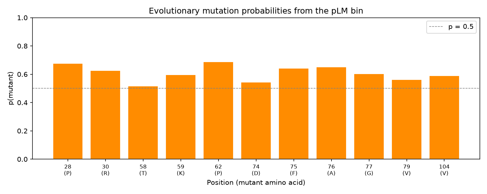

# eWHT: Evolutionary Walsh-Hadamard Transform for Fitness Landscapes

[](https://badge.fury.io/py/ewht)
[](https://opensource.org/licenses/MIT)
[](https://pypi.org/project/ewht/)
[](https://pypi.org/project/ewht/)
[](https://github.com/psf/black)
[](https://github.com/amirgroup-codes/ewht/commits/main)

`ewht` is a Python package for analyzing combinatorial fitness landscapes using the **evolutionary Walsh-Hadamard transform (eWHT)**. It provides:

- Fast **O(N log N)** forward and inverse eWHT transforms
- **Evolutionary mutation probabilities** `ps`, estimated from a landscape scored by **ESM2** or **AntiBERTy**
- **Data preprocessing** helpers (genotype encoding, train/test splits)
- **Compressed sensing** with Lasso on eWHT/WHT bases

## Installation

`ewht` supports Python 3.9 and above. Install from PyPI:

```sh
pip install ewht
```

Optional extras:

```sh
pip install ewht[esm]         # score with ESM2-650M (torch + transformers)
pip install ewht[antiberty]   # score with AntiBERTy (torch + antiberty)
pip install ewht[plm]         # both
```

## Quickstart

The package bundles the CR6261-H1 dataset from the paper, including a precomputed
`plm_score` column, so the whole pipeline runs without downloading a model. The full
script is in `example_ewht.py`:

```python
import ewht

# Load data and encode binary genotypes
raw = ewht.load_example()
df = ewht.genotypes_from_dataframe(raw, POSITIONS, wt_sequence=WT, mutants=MUTANTS)

# ps from the pLM-scored library: median split, then per-site mutation frequency
ps, scored = ewht.get_ps_from_library(df, scores=df["plm_score"], return_frame=True)
print(ps.round(3))
[0.677 0.627 0.517 0.597 0.688 0.545 0.644 0.651 0.604 0.563 0.59 ]

# Forward eWHT of the centered landscape
coeffs, center = ewht.efwht_from_dataframe(df, ps)

# Compressed sensing: 100 variants from the pLM bin, tested on the rest of the bin
measured = (scored["estimated_fitness"] == 0).to_numpy()
train, test = ewht.split_bin_train_test(
    scored[measured].reset_index(drop=True), 100, in_bin="plm_score_bin", random_state=0
)
for basis in ("eWHT", "WHT"):
    r = ewht.run_cs_experiment(train, test, ps, basis=basis, random_state=0)
    print(basis, round(r.test_metrics["r2"], 4))
eWHT 0.5992
WHT 0.4593
```

Run the full example:
```sh
python example_ewht.py
```

### Evolutionary mutation probabilities

The paper estimates `ps` from the **measured library**, not from the wild-type sequence
alone. Every variant is scored with a protein language model, the library is split at the
median score, and `p_i` is the fraction of variants in the upper half that carry a
mutation at site `i` (clipped to `[0.05, 0.95]`):

Give it a landscape CSV (or DataFrame) and pick a model. Either way you get back the
landscape plus `plm_score` and `plm_score_bin` (1 at or above the median, else 0), and
`ps` is read off the `plm_score_bin == 1` rows.

```python
# ESM2-650M, wildtype-marginal LLRs (default). Needs the library definition.
ps, scored = ewht.get_ps_from_library(
    "landscape.csv", "esm2",
    wt_sequence=WT, positions=POSITIONS, mutants=MUTANTS, return_frame=True,
)

# AntiBERTy, pseudo-log-likelihood per variant sequence. Antibodies only.
ps, scored = ewht.get_ps_from_library(
    "landscape.csv", "antiberty",
    sequence_col="mutated_sequence", return_frame=True,
)

scored[["genotype", "fitness", "plm_score", "plm_score_bin"]].head()
```

Scoring uses the model score as returned (LLR or pseudo-log-likelihood) — no
fitness-direction flip. Scoring a big library is expensive, so cache the scores and
feed them back rather than rescoring. The same hook takes scores from any other source
(another model, a second assay):

```python
ps = ewht.get_ps_from_library(df, scores=my_scores)
scored = ewht.score_landscape(df, scores=my_scores)  # just the frame
ps = ewht.ps_from_scored_landscape(scored)           # just the ps
```

<p align="center">
  
</p>

### eWHT spectrum

The forward transform decomposes the centered landscape into Walsh coefficients grouped by interaction order:

<p align="center">
  
</p>

## Core API

| Function | Description |
|----------|-------------|
| `efwht(y, ps)` | Forward eWHT on a length-`2^L` landscape vector |
| `iefwht(coeffs, ps)` | Inverse eWHT (exact round-trip with matching `norm`) |
| `efwht_from_dataframe(df, ps)` | Forward eWHT from a preprocessed DataFrame |
| `get_ps_from_library(data, model)` | Score a landscape and estimate `ps` (the paper's method) |
| `score_landscape(data, model)` | Landscape + `plm_score` + `plm_score_bin` |
| `ps_from_scored_landscape(df)` | `ps` from an already scored and binned frame |
| `get_ps_from_scores(df, scores)` | `ps` from a library scored by any model |
| `genotypes_from_dataframe(df, positions, wt_sequence, mutants)` | Build a binary genotype column from sequences |
| `split_bin_train_test(df, n_train, in_bin=...)` | Uniform train/test split inside a bin (the paper's protocol) |
| `sample_evolutionary_sequences(df, ps, ...)` | `ps`-weighted subsampling, with an optional MSA mask |
| `run_cs_experiment(train, test, ps)` | Lasso compressed sensing with CV on train |
| `get_basis(bin_seqs, ps)` | eWHT / WHT design matrix |

## Compressed sensing

`run_cs_experiment` follows the paper: an **expectation-norm design matrix** (the only
normalization it uses), an unpenalized intercept, and the Lasso `alpha` chosen by
`LassoCV` on a 30-point, data-dependent path over the training rows.

```python
r = ewht.run_cs_experiment(train, test, ps, basis="eWHT")
r.best_lambda, r.test_metrics, r.coeffs   # coeffs in expectation norm, lexicographic order
```

To compare bases fairly across `n`, draw one pool per seed and slice it, so the training
sets are nested and every basis sees identical data:

```python
for n in range(20, 201, 20):
    train, test = ewht.split_bin_train_test(df, n, in_bin=in_bin, pool_size=200, random_state=seed)
```

## Conventions

- Genotypes are 0/1 strings, `0` = wild-type and `1` = mutant. Pseudoboolean strings
  (`1` = wild-type, `-1` = mutant) are accepted too. For a custom mapping, add a
  `genotype` column directly instead of using `genotypes_from_dataframe`.
- **Site 0 is the most significant bit** of the genotype index, for both the transform and
  the design matrix, so `get_basis(...) @ coeffs` reproduces the landscape that `efwht`
  decomposed. Coefficients come back in lexicographic order unless `degree_order=True`.

## Optional dependencies

| Extra | Packages | Use case |
|-------|----------|----------|
| (default) | numpy, pandas, scipy, scikit-learn | transforms, `ps` from scores, MSA `ps`, CS |
| `ewht[esm]` | torch, transformers | scoring a landscape with ESM2-650M |
| `ewht[antiberty]` | torch, antiberty | scoring an antibody landscape with AntiBERTy |
| `ewht[plm]` | both of the above | either model |
