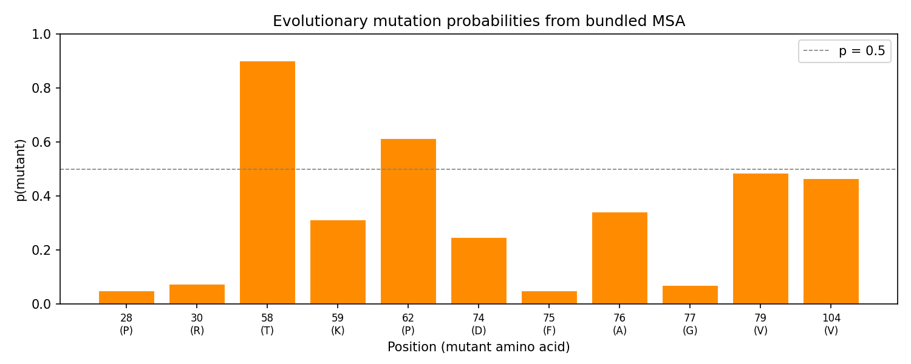
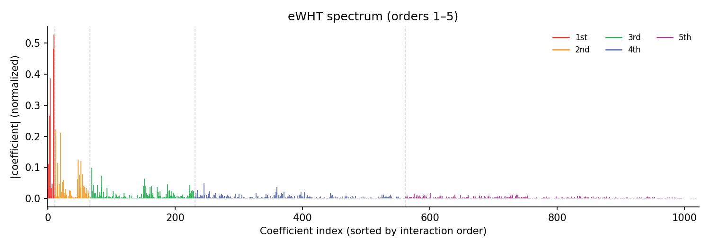

# eWHT: Evolutionary Walsh-Hadamard Transform for Fitness Landscapes

[](https://badge.fury.io/py/ewht)
[](https://opensource.org/licenses/MIT)
[](https://pypi.org/project/ewht/)
[](https://pypi.org/project/ewht/)
[](https://github.com/psf/black)
[](https://github.com/amirgroup-codes/ewht/commits/main)

`ewht` is a Python package for analyzing combinatorial fitness landscapes using the **evolutionary Walsh-Hadamard transform (eWHT)**. It provides:

- Fast **O(N log N)** forward and inverse eWHT transforms
- **Evolutionary mutation probabilities** `ps` from MSAs or ESM2-650M
- **Data preprocessing** helpers (genotype encoding, evolutionary subsampling)
- **Compressed sensing** with LASSO on eWHT/WHT bases

## Installation

`ewht` supports Python 3.9 and above. Install from PyPI:

```sh
pip install ewht
```

Optional extras:

```sh
pip install ewht[esm]   # ESM2-650M ps estimation (requires torch + transformers)
```

## Quickstart

The package contains an example CR6261-H1 dataset from the paper. Load it, estimate `ps` from MSA, compute the eWHT, and run compressed sensing. The full script can be found in `example_ewht.py`:

```python
import ewht

# Load data and preprocess
raw = ewht.load_example()
print(raw.head())
       mutant                                   mutated_sequence  fitness  estimated_fitness
0          WT  QVQLVESGAEVKKPGSSVKVSCKASGGTFSSYAISWVRQAPGQGPE...      7.0                  0
1       L104V  QVQLVESGAEVKKPGSSVKVSCKASGGTFSSYAISWVRQAPGQGPE...      7.0                  0
2        A79V  QVQLVESGAEVKKPGSSVKVSCKASGGTFSSYAISWVRQAPGQGPE...      7.0                  0
3  A79V;L104V  QVQLVESGAEVKKPGSSVKVSCKASGGTFSSYAISWVRQAPGQGPE...      7.0                  0
4        S77G  QVQLVESGAEVKKPGSSVKVSCKASGGTFSSYAISWVRQAPGQGPE...      7.0                  0
POSITIONS = [28, 30, 58, 59, 62, 74, 75, 76, 77, 79, 104]
MUTANTS = ["P", "R", "T", "K", "P", "D", "F", "A", "G", "V", "V"]
WT = (
    "QVQLVESGAEVKKPGSSVKVSCKASGGTFSSYAISWVRQAPGQGPEWMGGIIPIFGTANYAQKFQGRVTITADKSTSTAYMELSSLRSEDTAMYYCAKHMGYQLRETMDVWGQGTTVTVSS"
)
L = len(POSITIONS)
print(df.head())
print(f"{df['genotype'].nunique()} unique genotypes, L={L}")
       mutant                                   mutated_sequence  fitness  estimated_fitness     genotype
0          WT  QVQLVESGAEVKKPGSSVKVSCKASGGTFSSYAISWVRQAPGQGPE...      7.0                  0  00000000000
1       L104V  QVQLVESGAEVKKPGSSVKVSCKASGGTFSSYAISWVRQAPGQGPE...      7.0                  0  00000000001
2        A79V  QVQLVESGAEVKKPGSSVKVSCKASGGTFSSYAISWVRQAPGQGPE...      7.0                  0  00000000010
3  A79V;L104V  QVQLVESGAEVKKPGSSVKVSCKASGGTFSSYAISWVRQAPGQGPE...      7.0                  0  00000000011
4        S77G  QVQLVESGAEVKKPGSSVKVSCKASGGTFSSYAISWVRQAPGQGPE...      7.0                  0  00000000100
2048 unique genotypes, L=11

with example_msa() as msa_path:
    # Compute ps from MSA
    ps = get_ps(WT_SEQUENCE, POSITIONS, MUTANTS, msa=msa_path)
    plot_ps(ps, OUTPUT_DIR / "ps_from_msa.png")

    # Compute eWHT
    coeffs, center = efwht_from_dataframe(df, ps, basis="eWHT")
    plot_ewht_spectrum(coeffs, L, OUTPUT_DIR / "ewht_spectrum.png", max_order=MAX_ORDER)

    # Sample evolutionary sequences for compressed sensing
    train, test = sample_evolutionary_sequences(
        df,
        ps,
        msa=msa_path,
        positions=POSITIONS,
        wt_sequence=WT_SEQUENCE,
        mutants=MUTANTS,
        fraction=0.75,
        train_n=TRAIN_N,
        random_state=0,
    )
    print(f"train={len(train)}, test={len(test)}")
    train=100, test=162

    # Run compressed sensing experiment
    result = run_cs_experiment(train, test, ps, basis="eWHT", center_by_ps=True, random_state=0)
    print(f"best lambda: {result.best_lambda}")
    print(f"train R²: {result.train_metrics['r2']:.4f}")
    print(f"test R²:  {result.test_metrics['r2']:.4f}")
    best lambda: 0.005
    train R²: 0.9662
    test R²:  0.8282

print(f"Figures in {OUTPUT_DIR.resolve()}/")
```

Run the full example:
```sh
python example_ewht.py
```

### Evolutionary mutation probabilities

`get_ps` estimates per-site mutation probabilities from an MSA or, if no MSA is given, from ESM2-650M:

<p align="center">
  
</p>

### eWHT spectrum

The forward transform decomposes the centered landscape into Walsh coefficients grouped by interaction order:

<p align="center">
  
</p>

## Core API

| Function | Description |
|----------|-------------|
| `efwht_from_dataframe(df, ps)` | Forward eWHT from a preprocessed DataFrame |
| `efwht(y, ps)` | Forward eWHT on a length-`2^L` landscape vector |
| `iefwht(coeffs, ps)` | Inverse eWHT (exact round-trip with matching `norm`) |
| `get_ps(sequence, positions, mutants, msa=...)` | Per-site mutation probabilities |
| `genotypes_from_dataframe(df, positions, wt_sequence, mutants)` | Build binary genotype column from sequences |
| `sample_evolutionary_sequences(df, ps, ...)` | Evolutionary subsampling with optional MSA mask |
| `run_cs_experiment(train, test, ps)` | Lasso compressed sensing with CV on train |

## Genotype encodings

`ewht` accepts genotypes as:

- Binary strings: `"00101"` (`0` = WT, `1` = mutant)
- Pseudoboolean strings: `"1-1-11"` (`1` = WT, `-1` = mutant)

For custom mappings, add a `genotype` column directly instead of using `genotypes_from_dataframe`.

## Optional dependencies

| Extra | Packages | Use case |
|-------|----------|----------|
| (default) | numpy, pandas, scipy, scikit-learn | transforms, MSA-based ps, CS |
| `ewht[esm]` | torch, transformers | ps from ESM2-650M when no MSA is available |
